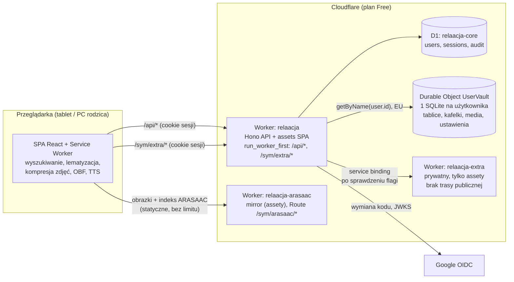

# relAACja — plan wdrożenia (v1, 2026-11-22)

Aplikacja webowa AAC (komunikacja wspomagająca i alternatywna) dla dzieci z trudnościami w komunikacji werbalnej. Rodzic loguje się kontem Google, buduje tablice z symboli ARASAAC i własnych zdjęć i udostępnia dziecku tablet lub komputer w **trybie komunikacji**.

Dokument jest kanonicznym opisem architektury. Bieżący backlog: [`TODO.md`](../TODO.md).

---

## 1. Rejestr decyzji (ADR-lite)

| # | Decyzja | Odrzucone alternatywy i powód |
|---|---|---|
| D1 | **Cloudflare Workers + Static Assets** (nie Pages) | Pages: Cloudflare rozwija dziś Workers jako platformę docelową; Durable Objects i tak muszą żyć w Workerze; `run_worker_first` daje bramkowanie assetów bez osobnego kodu. |
| D2 | **Dane użytkownika w Durable Object per użytkownik (SQLite)** — `UserVault`, adresowany `getByName(user.id)` w **jurysdykcji EU** (`DO_JURISDICTION=eu` na stagingu i produkcji; lokalny workerd jurysdykcji nie obsługuje). Zmiana jurysdykcji po starcie osierociłaby dane — pilnuje tego test konfiguracji | D1 ze wspólną tabelą + `owner_id` (izolacja zależna od dyscypliny w każdym zapytaniu, limit 500 MB/bazę, ręczny sharding mediów); D1 sharding (limit 10 baz na Free, routing po stronie aplikacji); KV (1000 zapisów/dzień); R2 (wymaga karty). DO daje **fizyczną izolację danych** — nie istnieje zapytanie, które mogłoby zwrócić cudze tablice. |
| D3 | **D1 `relaacja-core`** (jurysdykcja EU) wyłącznie na rejestr globalny: użytkownicy, sesje, role, audyt | Panel admina potrzebuje zapytań przekrojowych (lista kont, statusy) — tego DO per user nie da. |
| D4 | **Własny mirror ARASAAC** w Workerze z samymi assetami (`relaacja-arasaac`), podpiętym jako **Route** `/sym/arasaac/*` na hoście aplikacji (ten sam origin) + własny indeks wyszukiwania | Hotlink `static.arasaac.org` (zależność runtime, wyciek do strony trzeciej informacji, jakich piktogramów używa dziecko); proxy przez Worker (zjada limit 100k req/dzień); osobny host (CORS dla eksportu z `<canvas>`, szersze CSP). Assety statyczne są darmowe i bez limitu żądań. |
| D14 | **Domena `jagiellona.one.pl`**: Custom Domains `relaacja.` / `relaacja-staging.`, `workers_dev=false` i `preview_urls=false` we wszystkich Workerach | `*.workers.dev` (decyzja: własna domena). Konsekwencja: `one.pl` nie jest na Public Suffix List → ochrona CSRF nie może polegać na `SameSite` (§4.1); reguły WAF strefy obejmują aplikację. |
| D5 | **Opcjonalny dodatkowy zestaw symboli** (przyznawany przez admina per konto) w prywatnym Workerze z samymi assetami `relaacja-extra` (`workers_dev=false`, `preview_urls=false`, brak tras), osiągalnym **tylko przez service binding** `EXTRA_SET` z Workera głównego po sprawdzeniu sesji i flagi `extra_set_enabled` | Assety w Workerze głównym (pliki musiałyby trafić do repo i na runnery CI); R2 (karta); BLOB w D1 (limit 500 MB). Zawartość zestawu, narzędzia do jego budowy i jego deploy są poza tym repozytorium. |
| D6 | **Własny OIDC Authorization Code + PKCE** z Google, wymiana kodu po stronie Workera, **nieprzezroczysta sesja** w D1, cookie `__Host-` `HttpOnly` | Cloudflare Access (limit 50 miejsc, nie pasuje do otwartej rejestracji); Google Identity Services + JWT w `localStorage` (kradzież tokenu przy XSS); bezstanowy JWT jako sesja (brak natychmiastowej blokady konta). |
| D7 | **Frontend: React 19 + Vite + TypeScript + Tailwind CSS v4 + shadcn/ui (Radix) + TanStack Query + dnd-kit** | SvelteKit (mniejszy bundle, ale uboższy ekosystem komponentów a11y i drag&drop; różnica rozmiaru bez znaczenia w aplikacji online). |
| D8 | **Backend: Hono + Zod + `@cloudflare/vite-plugin`**, cała ciężka praca **po stronie klienta** (skalowanie i re-enkodowanie zdjęć, budowa ZIP `.obz`, wyszukiwanie, lematyzacja) | Python Workers (zimny start Pyodide, 10 ms CPU na Free); przetwarzanie obrazów w Workerze (przekroczenie 10 ms CPU → błąd 1102). Python/Go tylko w narzędziach offline (`tools/`). |
| D9 | **TTS: Web Speech API**, presety głosów przez dobór głosu + `pitch`/`rate` | Chmurowe TTS (karta, zależność), Piper WASM (decyzja: nie). |
| D10 | **Lematyzacja słownikowa: PoliMorf (BSD-2)** przefiltrowany do słownictwa symboli, serwowany jako statyczny asset | ARASAAC `/phrases/flex` (tylko `es` — zweryfikowane); LLM (zależność zewnętrzna); stemming heurystyczny (słaby dla polskiego). |
| D11 | **Brak trybu offline**. Jest manifest PWA (instalacja na ekranie głównym, tryb `standalone`) i Service Worker cache'ujący tylko powłokę aplikacji i obrazki symboli | Offline-first z synchronizacją — odrzucone (aplikacja online). |
| D12 | **Kafelek wskazuje konkretny obrazek** `{set, ref}`; ustawienie „aktywne zestawy” filtruje bibliotekę, wyszukiwarkę i generator fraz | Kafelek jako „pojęcie” renderowane w różnych zestawach — brak wspólnych ID między zestawami, mapowanie tylko po tekście. |
| D13 | **Monorepo pnpm**, TypeScript end-to-end, narzędzia Python przez `uv` | — |

---

## 2. Zakres funkcjonalny

### 2.1 Tryb komunikacji (dziecko, domyślny po zalogowaniu)
- **Pasek zdaniowy** u góry: symbole z etykietami, przewijany poziomo (maks. 30 elementów), przyciski **⌫** (usuń ostatni), **🗑** (wyczyść), **▶** (odtwórz całość). Dotknięcie symbolu w pasku → wypowiada go; przytrzymanie → usuwa.
- **Siatka tablicy**: stała liczba wierszy × kolumn na tablicę, puste pola dozwolone, kafelki **nigdy się nie przesuwają** (planowanie ruchowe). Przy innym rozmiarze ekranu siatka skaluje się, pozycje zostają.
- **Kafelek-słowo**: dotknięcie → natychmiast wypowiada etykietę i dopisuje symbol do paska.
- **Kafelek-folder**: dotknięcie → wypowiada nazwę i otwiera podtablicę (dowolna głębokość). Wizualnie odróżniony (zakładka teczki w rogu).
- Po wybraniu słowa: **powrót na pulpit** (domyślnie włączony; ustawienie).
- Nawigacja: 🏠 pulpit, ← wstecz, okruszki (`Pulpit › Jedzenie › Śniadanie`).
- **Historia** ostatnich 50 wypowiedzi i **ulubione frazy** (gwiazdka) — jedno dotknięcie odtwarza.
- **Wyszukiwarka** 🔍 (klawiatura systemowa, bez polskich znaków i z odmianą: „jablka” → jabłko). Dwa źródła z przełącznikiem w ustawieniach (`kafelki` / `biblioteka` / `oba` — domyślnie oba, jako zakładki):
  - *Moje kafelki* — wynik pokazuje ścieżkę; dotknięcie przenosi do folderu i podświetla kafelek.
  - *Biblioteka* — symbole z aktywnych zestawów; dotknięcie wypowiada i dodaje do paska.
- Ekran nie gaśnie (Wake Lock API); zablokowany pinch-zoom, zaznaczanie tekstu i menu kontekstowe przy przytrzymaniu.

### 2.2 Tryb rodzica (edycja)
- **Wejście**: przytrzymanie ikony 🔒 przez 2 s; opcjonalny 4-cyfrowy PIN (domyślnie wyłączony). Chroni przed przypadkową edycją, wylogowaniem i zmianą ustawień przez dziecko.
- **Edycja tablicy**: dodaj kafelek (słowo/folder), przeciągnij na inne pole (dnd-kit), usuń, zmień rozmiar siatki, utwórz podfolder, przenieś kafelek do innej tablicy.
- **Wybór symbolu**: wyszukiwarka biblioteki po aktywnych zestawach → **wszystkie warianty graficzne słowa obok siebie** (np. kilka symboli „nos” z różnych zestawów) → rodzic wybiera jeden. Wybór zapamiętywany jako *preferowany wariant słowa* (używany przy kolejnych wyszukiwaniach i w generatorze fraz).
- **Edycja kafelka**: treść etykiety (niezależna od nazwy symbolu), położenie etykiety (góra/dół), rozmiar czcionki (S/M/L/XL), kolor Fitzgerald Key jako tło lub ramka (automatyczna propozycja na podstawie części mowy, ręczna zmiana).
- **Własne symbole**: zdjęcie z galerii lub aparatu (`<input type="file" accept="image/*" capture>`), kadrowanie do kwadratu, kompresja w przeglądarce do WebP ≤ 512 px (re-enkodowanie usuwa EXIF z GPS), etykieta. Pojedynczo, wyłącznie do własnego konta (np. zdjęcia rodziny, PCS na własne potrzeby).
- **Ustawienia**:
  - aktywne zestawy (wielokrotny wybór: ARASAAC, dodatkowy — tylko jeśli przyznany, Własne) i ich kolejność w wynikach,
  - głos (preset + test + suwaki `rate`/`pitch`),
  - zachowanie (powrót na pulpit, źródła wyszukiwarki),
  - motoryka (§2.5),
  - filtr treści: piktogramy oznaczone przez ARASAAC jako `sex` (78) / `violence` (106) oraz odpowiadające im kategorie dodatkowego zestawu — **domyślnie ukryte**,
  - eksport/import OBF,
  - „wyloguj wszystkie urządzenia”.

### 2.3 Generator fraz (funkcjonalny odpowiednik AraWrite)
AraWrite (`arawrite.arasaac.org`) zamienia **tekst na ciąg piktogramów** z NLP, pozwala podmienić piktogram dla każdego słowa, skonfigurować wygląd i wydrukować / zapisać wynik. API ARASAAC oferuje odmianę gramatyczną (`/phrases/flex`) **tylko dla hiszpańskiego**, więc dla polskiego budujemy własny potok w przeglądarce:

1. **Wejście**: pole tekstowe (klawiatura systemowa) lub opcjonalnie dyktowanie (Web Speech Recognition `pl-PL`, tam gdzie przeglądarka wspiera).
2. **Tokenizacja**: `Intl.Segmenter('pl', {granularity: 'word'})`.
3. **Dopasowanie wielowyrazowe** (najdłuższe dopasowanie, okno 4→1): „dzień dobry”, „myć zęby”, „numer alarmowy 112”.
4. **Lematyzacja** pozostałych słów: forma → lemat(y) ze słownika PoliMorf („chcę” → chcieć, „jabłka” → jabłko, „piłem” → pić). Formy niejednoznaczne („mam” → mieć / mama) dają kilku kandydatów.
5. **Ranking kandydatów**: preferowany wariant użytkownika > kolejność aktywnych zestawów > flaga ARASAAC `aac` (rdzeń słownictwa AAC, 860 piktogramów) > zgodność części mowy > numer wariantu.
6. **Pasek wyniku**: piktogram + etykieta (domyślnie forma z tekstu, opcjonalnie lemat). Dotknięcie słowa → zmiana piktogramu (alternatywy, warianty, własne zdjęcie, „bez piktogramu”). Przełącznik „pomiń słowa funkcyjne” (i, w, na, z…).
7. **Wygląd**: etykieta góra/dół, rozmiar, kolory Fitzgerald jako tło lub ramka, wielkie litery.
8. **Akcje**: ▶ odczytaj, „do paska zdaniowego”, „do ulubionych”, „zapisz jako tablicę”, eksport PNG (render na `<canvas>`), druk (CSS `@media print`). Na wydrukach i w PNG — stopka z atrybucją ARASAAC.

Dostępny w trybie rodzica i — jeśli rodzic włączy — z poziomu trybu komunikacji.

### 2.4 Synteza mowy (Web Speech API)
- Lista głosów `speechSynthesis.getVoices()` filtrowana do `pl-*` (ładowanie asynchroniczne — zdarzenie `voiceschanged`).
- **Presety** (zapisywane na koncie):

  | Preset | Głos bazowy | `pitch` | `rate` |
  |---|---|---|---|
  | Kobieta (domyślny) | głos żeński | 1.0 | 0.95 |
  | Mężczyzna | głos męski (gdy brak → żeński, `pitch` 0.8) | 1.0 | 0.95 |
  | Dziewczynka | głos żeński | 1.6 | 1.05 |
  | Chłopiec | głos męski (gdy brak → żeński, `pitch` 1.3) | 1.45 | 1.05 |

- **Przypisanie konkretnego głosu do presetu jest per urządzenie** (`localStorage`), bo nazwy głosów różnią się między Androidem, iOS, Windows/Edge i macOS. Preset i suwaki — per konto.
- **Ograniczenia, które trzeba znać:**
  - nigdzie nie ma prawdziwych głosów dziecięcych — „dziewczynka/chłopiec” to przesunięcie wysokości;
  - Chrome na Androidzie często udostępnia **jeden** polski głos (płeć wybiera się w systemowych ustawieniach TTS), wtedy presety różnią się tylko `pitch`/`rate`;
  - Edge na Windows udostępnia neuronowe głosy online (np. Zofia, Marek);
  - na iOS pierwsza wypowiedź musi nastąpić po geście użytkownika.
- Obejścia: `cancel()` przed każdym `speak()` (brak kolejkowania), dzielenie długich tekstów na zdania (Chrome ucina wypowiedzi po ~15 s), przycisk „Test głosu”.

### 2.5 Motoryka i dostępność — wartości domyślne

| Parametr | Domyślnie | Zakres |
|---|---|---|
| Aktywacja | przy puszczeniu palca (`pointerup`); anulowanie, gdy palec zjedzie poza kafelek (> 12 px) | przy dotknięciu / przy puszczeniu |
| Ignorowanie powtórnego dotknięcia tego samego kafelka | 400 ms | 0–2000 ms |
| Globalna blokada po aktywacji (przypadkowe wielokrotne dotknięcia) | 150 ms | 0–1000 ms |
| Minimalny czas przytrzymania | wyłączony | 150 / 300 / 500 / 800 / 1200 ms (z pierścieniem postępu) |
| Dodatkowe palce / dłoń oparta o ekran | ignorowane (tylko pierwszy `pointer`) | — |
| Minimalny rozmiar kafelka | 72 px (tablet), 56 px (telefon) | — |
| Informacja zwrotna | podświetlenie 150 ms + wibracja 20 ms (Android) | wł./wył. |
| Wielkie litery w etykietach | wyłączone | wł./wył. |

Kolejne etapy (backlog): skanowanie przełącznikami, motyw wysokiego kontrastu. W pomocy aplikacji: instrukcja „Dostęp z przewodnikiem” (iOS) i „Przypinanie ekranu” (Android) — kiosk na poziomie systemu.

### 2.6 Panel administratora
- **Lista kont**: e-mail, nazwa, data utworzenia, ostatnie logowanie, status, rola, flaga dodatkowego zestawu, zajęte miejsce.
- **Akcje**:
  - zablokuj / odblokuj (zablokowany widzi komunikat „Konto zablokowane”, dane zostają, wszystkie sesje unieważnione),
  - **twarde usunięcie** (wszystkie dane: wiersz w D1, sesje, `deleteAll()` w DO; potwierdzenie wpisaniem e-maila),
  - włącz / wyłącz dodatkowy zestaw,
  - nadaj / odbierz rolę `admin`.
- **Podgląd danych użytkownika** (tablice, symbole, ustawienia) — tylko odczyt, każde otwarcie zapisywane w audycie.
- **Role**: `superadmin` — 2 adresy z sekretu `ADMIN_EMAILS`, nadawane przy logowaniu, **nieodbieralne z aplikacji** (ochrona przed zablokowaniem się); `admin` — nadawany w aplikacji; `user`.
- **Dziennik audytu** wszystkich akcji administracyjnych (kto, kiedy, na kim, co).

### 2.7 Szablon startowy
Nowe konto dostaje gotowy pulpit zbudowany z ARASAAC (preferowane piktogramy z flagą `aac`). Siatka pulpitu 6 × 4, podtablice 5 × 4. Generuje go skrypt `tools/template/`, wynik trafia do repo jako `templates/starter.json` (tylko ID ARASAAC — bez obrazków). Akceptowany na podglądzie HTML przed wdrożeniem.

- **Pulpit**: Ja, Ty, Chcę, Nie chcę, Tak, Nie, Proszę, Dziękuję, Pomocy + foldery
- **Osoby**: ja, ty, mama, tata, siostra, brat, babcia, dziadek, pani, pan, kolega, koleżanka
- **Jedzenie** → *Śniadanie* (chleb, masło, ser, szynka, jajko, płatki, mleko, kanapka, dżem) · *Obiad* (zupa, mięso, ziemniaki, kotlet, surówka, makaron, ryż, ryba) · *Kolacja* · *Przekąski i owoce*
- **Picie**: woda, sok, mleko, herbata, kakao, kompot
- **Uczucia**: wesoły, smutny, zły, zmęczony, boję się, boli
- **Ciało**: głowa, brzuch, nos, ucho, ręka, noga, ząb + „boli”
- **Miejsca**: dom, szkoła, przedszkole, park, sklep, toaleta, plac zabaw
- **Zabawa**: klocki, piłka, rower, bajka, rysować, huśtawka
- **Ubrania**: koszulka, spodnie, buty, kurtka, czapka, piżama
- **Zwroty**: cześć, pa pa, jeszcze, koniec, przerwa, nie wiem, nie rozumiem
- **Pytania**: co?, gdzie?, kto?, kiedy?, dlaczego?

### 2.8 Eksport / import — Open Board Format (OBF)
- Eksport całego konta lub pojedynczej tablicy do `.obz` (ZIP: `manifest.json` + pliki `.obf` + obrazy), budowany w przeglądarce (`fflate`).
- Pola OBF: `grid` (`rows`, `columns`, `order`), `buttons` (`label`, `image_id`, `background_color`, `border_color`, `load_board`), `images` z polem `license` (ARASAAC: CC BY-NC-SA, autor Sergio Palao).
- Rozszerzenia `ext_relaacja_*`: odwołanie do symbolu (`set`, `ref`), położenie etykiety, rozmiar czcionki, rola Fitzgerald — dzięki temu eksport → import jest bezstratny.
- Import: rozpoznanie obrazów ARASAAC i dodatkowego zestawu po `ext_relaacja_symbol` (lub URL), pozostałe jako własne symbole; walidacja schematu (Zod), limity rozmiaru, partie po ≤ 200 kafelków na żądanie (limit 10 ms CPU).

### 2.9 Atrybucja ARASAAC (licencja CC BY-NC-SA 4.0)
Treść: *„Autor piktogramów: Sergio Palao. Pochodzenie: ARASAAC (https://arasaac.org). Licencja: CC (BY-NC-SA). Właściciel: Rząd Aragonii (Hiszpania).”*

Gdzie się pojawia:
1. Strona „O aplikacji” (pełna nota, link do licencji, informacja, że mirror zawiera obrazy przekonwertowane do WebP na tej samej licencji).
2. Publiczna strona startowa z logowaniem (stopka, jedna linia).
3. Stopka biblioteki symboli w trybie rodzica (jedna linia).
4. Wydruki i eksport PNG z generatora fraz (stopka).
5. Pole `license` każdego obrazu ARASAAC w eksporcie OBF.

**Nie** na kafelkach w trybie komunikacji — zaśmiecałoby interfejs AAC. Kod aplikacji zostaje na licencji MIT; plik `NOTICE` wyjaśnia, że zasoby ARASAAC mają osobną licencję i nie są częścią repo.

---

## 3. Architektura



### 3.1 Workery

| Worker | Zawartość | Dostęp | Deploy |
|---|---|---|---|
| `relaacja` | SPA (assety), API Hono, klasa DO `UserVault`; wiązania: D1 `DB`, DO `USER_VAULT`, service binding `EXTRA_SET` | Custom Domain `relaacja.jagiellona.one.pl` | GitHub Actions |
| `relaacja-staging` | to samo, osobna baza D1 i przestrzeń DO | Custom Domain `relaacja-staging.jagiellona.one.pl` | GitHub Actions |
| `relaacja-extra` | assety dodatkowego zestawu + indeks i słownik odmian (zawartość poza repozytorium); skrypt sprowadzony do `env.ASSETS.fetch()` | **tylko service binding**; `workers_dev=false`, `preview_urls=false`, brak `routes` | ręcznie z maszyny operatora (`wrangler deploy --assets <katalog>`), poza CI |
| `relaacja-arasaac` | sam katalog assetów, bez skryptu (żądania nie są liczone do limitu): 12 712 WebP (~185 MB) + indeks i słownik w `sym/arasaac/` + `_headers` | Route `relaacja.jagiellona.one.pl/sym/arasaac/*` i to samo na stagingu (Route ma pierwszeństwo przed Custom Domain; brakujący plik → `404`, bez przejścia do aplikacji) | GitHub Actions (`arasaac-refresh.yml`, 2× w tygodniu) |

Limit plików na wersję Workera Free to 20 000 — każdy zestaw ma osobny Worker, więc żaden się do niego nie zbliża (największy ok. 15 tys.).

### 3.2 Budżet limitów planu Free (szacunek: 50 kont, 20 aktywnych dziennie)

| Zasób | Limit Free | Szacowane zużycie | Uwagi |
|---|---|---|---|
| Żądania Workera | 100 000 / dzień | ~6 000 | ~300 / aktywnego użytkownika (API + pierwsze pobrania obrazków dodatkowego zestawu) |
| Żądania DO | 100 000 / dzień | ~2 000 | |
| Czas DO | 13 000 GB-s / dzień | < 500 GB-s | DO aktywny tylko podczas żądań |
| D1 — odczyty | 5 mln wierszy / dzień | ~15 000 | sprawdzenie sesji = 1 zapytanie z JOIN |
| D1 — zapisy | 100 000 / dzień | ~200 | `last_seen` aktualizowane najwyżej raz na godzinę na sesję |
| DO — zapisy SQL | 100 000 / dzień | ~3 000 | |
| Miejsce w DO | 5 GB łącznie | ~0,9 GB | 50 kont × 300 zdjęć × ~60 KB |
| Miejsce w D1 | 500 MB / baza | < 10 MB | |
| CPU | 10 ms / żądanie | < 3 ms typowo | ciężka praca po stronie klienta (D8) |
| Assety statyczne | bez limitu | — | ARASAAC, SPA |

Po przekroczeniu limitu Cloudflare zwraca błędy do 00:00 UTC (bez opłat). Zabezpieczenie: obrazki z nagłówkiem `Cache-Control: private, max-age=31536000, immutable` (każdy pobierany przez przeglądarkę raz), test E2E pilnujący liczby żądań na typową sesję oraz opcjonalny dzienny raport zużycia (§8).

### 3.3 Zestawy symboli

| Zestaw | Źródło | Format docelowy | Rozmiar | Dostęp |
|---|---|---|---|---|
| ARASAAC | `api.arasaac.org/v1/pictograms/all/pl` (13 924 piktogramy, 12 712 z polskimi hasłami — tylko te trafiają do mirrora) + `static.arasaac.org/.../{id}_500.png` | WebP bezstratny 500 px (dla płaskiej grafiki równie mały jak stratny, bez artefaktów), nazwa `p/{id}.{hash8}.webp` | ~185 MB (śr. 14,5 KB) | wszyscy |
| Dodatkowy (opcjonalny) | poza repozytorium | WebP bezstratny maks. 512 px, nazwa `x/{id}.{hash8}.webp` | — | `users.extra_set_enabled = 1` |
| Własne | upload rodzica | WebP ≤ 512 px, BLOB w DO | ~30–80 KB / zdjęcie | tylko właściciel (+ admin) |

**Pliki zestawu** (katalog `/sym/<zestaw>/`, generowane przez `tools/relaacja_tools/symbolset.py`, czytane przez `packages/shared/src/symbols.ts`; zgodność pilnują wspólne wektory `packages/shared/test-vectors/sample-*.json`):
- `manifest.json` (`Cache-Control: no-cache`, rewalidacja ETag) — wskazuje bieżący indeks i słownik, liczbę symboli i nazwę zestawu;
- `index.{hash8}.json` (`immutable`) — pozycje `{id, f: plik, k: hasła, r: rola Fitzgerald, x: flagi aac=1/sex=2/violence=4, c: kategoria}`, posortowane po `id`; formy znormalizowane liczy klient przy wczytaniu (indeks ARASAAC: 1,1 MB, 0,3 MB po kompresji);
- `forms.{hash8}.json` (`immutable`) — słownik odmian (niżej).

Kompresję (brotli/gzip) robi krawędź Cloudflare. Wyszukiwanie w całości po stronie klienta — zero obciążenia serwera.

**Normalizacja** (wspólna dla TypeScript i Pythona, ze wspólnymi wektorami testowymi): `lower()`, `ł→l`, NFKD, usunięcie znaków łączących, znaki inne niż litery i cyfry → spacja, redukcja spacji.

**Słownik odmian**: PoliMorf 0.6.7 (BSD-2, `zil.ipipan.waw.pl/PoliMorf`, plik weryfikowany SHA-256) przefiltrowany do lematów osiągalnych ze słownictwa zestawu (słowo hasła jest lematem albo formą lematu, np. „jabłkami” → jabłko) → `forms.{hash8}.json` `{lemat: [formy]}`. ARASAAC: 9 973 lematy, 186 tys. form, 2,6 MB (0,5 MB po kompresji). Każdy zestaw ma własny słownik (dodatkowy zestaw nie ujawnia słownictwa w publicznym), klient je scala.

**Wyszukiwarka** (`packages/shared/src/search.ts`): każde słowo zapytania musi pasować do słowa hasła — dokładnie, przez wspólny lemat albo (ostatnie słowo w trakcie pisania, ≥ 2 znaki) jako prefiks. Kolejność: jakość dopasowania (całe hasło > hasło dłuższe; dokładne > lemat > prefiks; pierwsze hasło symbolu) > kolejność aktywnych zestawów > flaga `aac` > kolejność w indeksie. Filtr `sex`/`violence` z ustawień konta.

**Automatyczne kolory Fitzgerald Key**:
- ARASAAC `keyword.type`: 1 nazwy własne → żółty, 2 rzeczowniki → pomarańczowy, 3 czasowniki → zielony, 4 określenia → niebieski, 5 zwroty społeczne → różowy, 6 inne → biały.
- Dodatkowy zestaw — mapowanie kategorii na kolory zapisane w jego indeksie.

### 3.4 Uwierzytelnianie i sesje
1. `GET /api/auth/login` → generuje `state`, `nonce`, `code_verifier` (PKCE S256) i zapisuje je w krótkotrwałym (10 min), **zaszyfrowanym** cookie `__Host-relaacja_oauth` (AES-GCM, klucz z sekretu) — zero zapisów do D1 → przekierowanie do Google (`scope=openid email profile`, `prompt=select_account`).
2. `GET /api/auth/callback` → weryfikacja `state` → wymiana `code` na tokeny (fetch do Google) → weryfikacja `id_token`: podpis RS256 przez WebCrypto (JWKS w cache), `iss`, `aud`, `exp`, `nonce`, `email_verified=true`.
3. Tożsamość = Google **`sub`** (nie e-mail). Upsert w `users`; jeśli e-mail jest w `ADMIN_EMAILS` → `role='superadmin'`.
4. Konto `blocked` → strona „Konto zablokowane”, brak sesji.
5. Sesja: 256-bitowy losowy token w cookie `__Host-relaacja_sid` (`Secure; HttpOnly; SameSite=Lax; Path=/`); w D1 tylko `SHA-256(token)`. Wygasanie: 90 dni od ostatniego użycia, maks. 365 dni (współdzielony tablet nie powinien wylogowywać dziecka).
6. Każde żądanie API: jedno zapytanie D1 (sesja JOIN użytkownik) → kontekst `{userId, role, status, extraSet}`. **Jedyne źródło tożsamości** w kodzie.
7. **Strony publiczne** (bez sesji, statyczne, prerenderowane): `/` — opis aplikacji, przycisk „Zaloguj przez Google”, linki do `/prywatnosc` i „O aplikacji”; `/prywatnosc` — polityka prywatności. Google wymaga obu adresów do publikacji aplikacji *External*; strona domowa nie może być samym ekranem logowania i musi linkować politykę.
8. Ekran zgody Google pokazuje domenę zamiast nazwy aplikacji: weryfikacja marki wymaga własności `one.pl` w Search Console (domena autoryzowana = `one.pl`, bo `one.pl` jest poza PSL). Zakresy `openid email profile` są niewrażliwe, więc nie ma ekranu „aplikacja niezweryfikowana”.

### 3.5 Model danych

**D1 `relaacja-core`** (migracje `wrangler d1 migrations`):
```sql
CREATE TABLE users (
  id TEXT PRIMARY KEY,                -- random 128-bit, base32
  google_sub TEXT NOT NULL UNIQUE,
  email TEXT NOT NULL,
  display_name TEXT,
  role TEXT NOT NULL DEFAULT 'user' CHECK (role IN ('user','admin','superadmin')),
  status TEXT NOT NULL DEFAULT 'active' CHECK (status IN ('active','blocked','deleting')),
  extra_set_enabled INTEGER NOT NULL DEFAULT 0,
  storage_bytes INTEGER NOT NULL DEFAULT 0,
  created_at INTEGER NOT NULL,
  last_login_at INTEGER,
  blocked_at INTEGER
);
CREATE TABLE sessions (
  token_hash TEXT PRIMARY KEY,
  user_id TEXT NOT NULL REFERENCES users(id) ON DELETE CASCADE,
  created_at INTEGER NOT NULL,
  last_seen_at INTEGER NOT NULL,
  expires_at INTEGER NOT NULL
);
CREATE INDEX idx_sessions_user ON sessions(user_id);
CREATE TABLE admin_audit (
  id TEXT PRIMARY KEY,
  at INTEGER NOT NULL,
  actor_user_id TEXT NOT NULL,
  action TEXT NOT NULL,
  target_user_id TEXT,
  details TEXT                        -- JSON, no PII beyond IDs
);
```

**DO `UserVault`** (SQLite per użytkownik; własny runner migracji w `blockConcurrencyWhile`):
```sql
CREATE TABLE boards (
  id TEXT PRIMARY KEY, name TEXT NOT NULL,
  parent_board_id TEXT REFERENCES boards(id),   -- NULL = home board
  rows INTEGER NOT NULL, cols INTEGER NOT NULL,
  updated_at INTEGER NOT NULL, rev INTEGER NOT NULL DEFAULT 1
);
CREATE TABLE tiles (
  id TEXT PRIMARY KEY,
  board_id TEXT NOT NULL REFERENCES boards(id) ON DELETE CASCADE,
  row INTEGER NOT NULL, col INTEGER NOT NULL,
  kind TEXT NOT NULL CHECK (kind IN ('word','folder')),
  target_board_id TEXT REFERENCES boards(id),
  label TEXT NOT NULL,
  label_position TEXT NOT NULL DEFAULT 'bottom' CHECK (label_position IN ('top','bottom')),
  font_size TEXT NOT NULL DEFAULT 'M' CHECK (font_size IN ('S','M','L','XL')),
  color_role TEXT,                               -- Fitzgerald category
  color_mode TEXT NOT NULL DEFAULT 'border' CHECK (color_mode IN ('background','border')),
  symbol_set TEXT NOT NULL CHECK (symbol_set IN ('arasaac','extra','own')),
  symbol_ref TEXT NOT NULL,
  updated_at INTEGER NOT NULL, rev INTEGER NOT NULL DEFAULT 1,
  UNIQUE (board_id, row, col)
);
CREATE TABLE media (
  id TEXT PRIMARY KEY, label TEXT NOT NULL, mime TEXT NOT NULL,
  width INTEGER NOT NULL, height INTEGER NOT NULL, bytes INTEGER NOT NULL,
  sha256 TEXT NOT NULL, data BLOB NOT NULL, created_at INTEGER NOT NULL
);
CREATE TABLE settings (key TEXT PRIMARY KEY, value TEXT NOT NULL);       -- JSON values
CREATE TABLE preferred_symbols (word_norm TEXT PRIMARY KEY, symbol_set TEXT NOT NULL, symbol_ref TEXT NOT NULL);
CREATE TABLE phrase_history (id TEXT PRIMARY KEY, at INTEGER NOT NULL, items TEXT NOT NULL);
CREATE TABLE favorites (id TEXT PRIMARY KEY, name TEXT, items TEXT NOT NULL, position INTEGER NOT NULL);
```
- Struktura drzewa: folder = kafelek `kind='folder'` → `target_board_id`. Serwer odrzuca cykle i osierocone tablice.
- Optymistyczna współbieżność: `rev` w żądaniach zapisu (dwa urządzenia rodzica naraz → `409`, klient odświeża).
- Kwota na konto: 100 MB mediów / 2000 zdjęć, 500 tablic, 20 000 kafelków.

### 3.6 API (wycinek)
| Metoda i ścieżka | Opis |
|---|---|
| `GET /api/me` | profil, rola, status, dostępne zestawy + URL-e indeksów |
| `GET /api/boards/home`, `GET /api/boards/:id` | tablica z kafelkami |
| `POST/PATCH/DELETE /api/boards…`, `/api/tiles…` | edycja (z `rev`) |
| `POST /api/tiles/move` | przeniesienie / zamiana miejsc |
| `POST /api/media` (≤ 1 MB), `GET /api/media/:id` | własne symbole |
| `GET/PUT /api/settings` | ustawienia |
| `GET/POST /api/history`, `/api/favorites` | historia, ulubione |
| `POST /api/import/batch` | import OBF partiami |
| `GET /sym/extra/*` | brama dodatkowego zestawu |
| `GET /api/admin/users`, `POST /api/admin/users/:id/{block,unblock,extra-set,role}`, `DELETE /api/admin/users/:id`, `GET /api/admin/users/:id/boards…`, `GET /api/admin/audit` | administracja |

---

## 4. Bezpieczeństwo

### 4.1 Model zagrożeń i kontrole

| Zagrożenie | Kontrola |
|---|---|
| **Dostęp do cudzych danych (IDOR)** | Dane użytkownika fizycznie w jego DO; stub DO wyznaczany wyłącznie z `session.userId` — **żaden parametr żądania nie wybiera DO** (poza endpointami admina po sprawdzeniu roli). ID obiektów wewnątrz DO nie mają znaczenia poza nim. |
| **Enumeracja** | Wszystkie ID losowe 128-bit (base32); identyczna odpowiedź `404` dla „nie istnieje” i „nie twoje”; brak ID użytkowników w URL-ach poza panelem admina; rate limiting `/api/auth/*` regułą strefy (jedyna reguła planu Free — dlatego inne ścieżki API nie zawierają `/auth` ani `/login`) + limit per użytkownik w DO dla zapisów. |
| **Path traversal** | Brak systemu plików. Media po ID z bazy. Brama dodatkowego zestawu: **surowa** ścieżka (bez dekodowania — poprawne nazwy nie wymagają kodowania, więc każde `%..`, `\`, `..` czy znak spoza ASCII odpada) musi pasować do `^/sym/extra/(x/[0-9]{1,10}\.[0-9a-f]{8}\.webp\|(index\|forms)\.[0-9a-f]{8}\.json\|manifest\.json)$`; do Workera prywatnego idzie nowe żądanie bez nagłówków klienta (poza `If-None-Match`), a typ treści i nagłówki odpowiedzi ustawia brama. Binding `ASSETS` serwuje tylko pliki z manifestu wdrożenia. |
| **Złośliwy upload** | Re-enkodowanie w przeglądarce (usuwa EXIF/GPS); serwer: ≤ 1 MB, sprawdzenie sygnatury (WebP/PNG/JPEG), odczyt wymiarów z nagłówka, **odrzucenie SVG**, typ MIME ustawia serwer, `X-Content-Type-Options: nosniff`, `Content-Disposition: inline`, `Content-Security-Policy: default-src 'none'` na odpowiedziach z mediami. |
| **XSS** | Escapowanie w React, zakaz `dangerouslySetInnerHTML` (reguła ESLint), ścisłe CSP: `default-src 'self'; img-src 'self' blob: data:; connect-src 'self'; script-src 'self'; style-src 'self'; object-src 'none'; base-uri 'none'; frame-ancestors 'none'`. |
| **CSRF** | `one.pl` nie jest na Public Suffix List, więc **każda** domena `*.one.pl` (inne hosty w tej strefie i domeny innych abonentów `one.pl`) jest dla przeglądarki *same-site* i `SameSite=Lax` nie chroni. Dlatego przy każdym zapisie: **dokładne** porównanie `Origin` z originem aplikacji + `Sec-Fetch-Site: same-origin` + wymagany `Content-Type: application/json` i nagłówek `X-Relaacja` (prosty formularz HTML nie może ich wysłać). `SameSite=Lax` zostaje jako dodatkowa warstwa. |
| **Cookie tossing** (subdomeny `*.one.pl` ustawiające cookie z `Domain=one.pl`) | Wyłącznie cookie z prefiksem `__Host-` (przeglądarka nie pozwala ustawić ich z atrybutem `Domain`); serwer ignoruje cookie o innych nazwach i odrzuca (`400 cookie_conflict`) żądania, w których `__Host-relaacja_sid` lub `__Host-relaacja_oauth` występuje więcej niż raz (np. bezimienne cookie z sąsiedniej domeny). |
| **Wpływ na inne serwisy *same-site*** | XSS w relAACja pozwoliłby wysyłać żądania *same-site* do innych hostów `*.one.pl` z cookie ich użytkowników. Mitygacja po stronie aplikacji: ścisłe CSP bez `unsafe-inline`/`unsafe-eval`, media nigdy jako HTML (`sandbox`, `nosniff`). Inne serwisy w tej przestrzeni muszą mieć własną ochronę CSRF niezależną od `SameSite`. |
| **Przejęcie sesji** | Cookie `__Host-` `HttpOnly` `Secure`; tylko hash w D1; rotacja tokenu po zalogowaniu; „wyloguj wszystkie urządzenia”; blokada konta unieważnia sesje natychmiast. |
| **Eskalacja uprawnień** | Rola czytana z D1 przy każdym żądaniu; `superadmin` wyłącznie z sekretu `ADMIN_EMAILS`, sprawdzanego **przy każdym żądaniu** (usunięcie adresu działa natychmiast, bez ponownego logowania; sama rola zapisana w D1 nic nie daje); admin nie może odebrać roli `superadmin` ani zablokować / usunąć `superadmin`; audyt. |
| **Wyciek dodatkowego zestawu** | Brak publicznej trasy do `relaacja-extra`; pliki nigdy w repo ani na runnerach CI; `Cache-Control: private`; `X-Robots-Tag: noindex`; `Cross-Origin-Resource-Policy: same-origin`. Znane ograniczenie: po odebraniu dostępu obrazki już pobrane zostają w cache przeglądarki tej osoby. |
| **Sekrety** | `wrangler secret` (`GOOGLE_CLIENT_ID`, `GOOGLE_CLIENT_SECRET`, `OAUTH_COOKIE_KEY`, `ADMIN_EMAILS`); `.dev.vars` w `.gitignore`; GitHub Actions: `CLOUDFLARE_API_TOKEN`, `CLOUDFLARE_ACCOUNT_ID`; logi bez PII (tylko skrót ID użytkownika). |
| **Łańcuch dostaw** | Plik blokady wersji (lockfile), Dependabot, CodeQL, `pnpm audit` w CI, akcje GitHub przypięte do SHA, `actionlint` + `zizmor`; token Cloudflare jako sekret środowisk `staging`/`production` (tylko z `main`), widoczny wyłącznie w krokach `wrangler`, nie w instalacji zależności ani buildzie; brak `workflow_run`/`pull_request_target`. |
| **Tryb deweloperski logowania** | Atrapa logowania (`DEV_AUTH`) tylko w `.dev.vars`; test w CI sprawdza, że konfiguracja produkcyjna jej nie zawiera, a kod dodatkowo odrzuca ją, gdy host ≠ `localhost`. |

### 4.2 Nagłówki globalne
`Strict-Transport-Security: max-age=63072000; includeSubDomains`, `Referrer-Policy: no-referrer`, `X-Content-Type-Options: nosniff`, `Permissions-Policy: camera=(self), microphone=(self), geolocation=()`, `Cross-Origin-Opener-Policy: same-origin`, CSP jak wyżej.

### 4.3 Usunięcie konta (twarde)
`status='deleting'` → `UserVault.deleteAll()` (+ `deleteAlarm()`) → `DELETE FROM users` (kaskadowo sesje) → wpis w audycie (bez danych osobowych usuniętego, tylko ID). Operacja idempotentna — przerwana kończy się przy ponowieniu.

---

## 5. Struktura repozytorium

```text
relAACja/
├── app/                      # main Worker + SPA (one Vite project, @cloudflare/vite-plugin)
│   ├── src/client/           # React SPA
│   ├── src/worker/           # Hono API, auth, admin, UserVault DO
│   ├── migrations/           # D1 migrations
│   ├── e2e/                  # Playwright
│   └── wrangler.jsonc        # envs: staging, production
├── packages/shared/          # Zod schemas, types, normalization, OBF codec, test vectors
├── workers/
│   ├── extra/                # private assets Worker for the optional extra set (assets never in this repo)
│   └── arasaac/              # public mirror Worker
├── tools/                    # Python (uv): build_arasaac.py, build_lexicon.py, template/
├── templates/starter.json
├── docs/PLAN.md
├── NOTICE                    # third-party asset licences (ARASAAC)
└── TODO.md
```

---

## 6. Środowiska i wdrażanie

| Środowisko | Worker / adres | D1 | Google OAuth client | Dodatkowy zestaw |
|---|---|---|---|---|
| lokalne | `vite dev` (Miniflare: lokalne D1 i DO) | lokalna | `relaacja-dev` (`http://localhost:5173`) | próbka 50 symboli (gitignored) |
| staging | `relaacja-staging.jagiellona.one.pl` | `relaacja-core-staging` | `relaacja-dev` | pełny (ten sam prywatny Worker) |
| produkcja | `relaacja.jagiellona.one.pl` | `relaacja-core` | `relaacja-prod` | pełny |

Strefa `jagiellona.one.pl`: Configuration Rule wyłączająca Email Obfuscation dla hostów `relaacja*` (przepisywanie HTML koliduje z CSP) i limit żądań na ścieżkach logowania (`/api/auth/*`) — dlatego pozostałe ścieżki API nie zawierają `/auth` ani `/login`. Reszta konfiguracji strefy nie jest częścią repozytorium.

**GitHub Actions:**
- `ci.yml` (PR i push):
  - instalacja zależności (`pnpm install --frozen-lockfile`),
  - ESLint i Prettier, `tsc`,
  - Vitest (z `@cloudflare/vitest-pool-workers`),
  - build,
  - Playwright na lokalnym `wrangler dev`,
  - `uv run pytest` i `ruff` dla `tools/`,
  - CodeQL.
- `deploy.yml` (push na `main`; najpierw wywołuje `ci.yml` jako workflow wielokrotnego użytku — bez `workflow_run`/`pull_request_target`, więc kod z forków nigdy nie dostaje sekretów deployu):
  1. `wrangler d1 migrations apply --remote`, `CLOUDFLARE_ENV=staging vite build`, `wrangler deploy`, testy dymne (`app/scripts/smoke.sh`);
  2. **akceptacja ręczna** (GitHub Environment `production` z wymaganym recenzentem);
  3. migracje i deploy produkcji.

  Zero buildów po stronie Cloudflare, więc limit 500 buildów/mies. nie ma znaczenia.
- `arasaac-refresh.yml`: 2× w tygodniu (pon., czw.) i ręcznie — pełny katalog `/pictograms/all/pl` (6 MB) porównany z `lastUpdated` zapisanym przy każdym obrazku w `actions/cache`, pobierane tylko nowe i zmienione piktogramy (bez dziur po nieudanym przebiegu, jak przy `/days/N`); przebieg co kilka dni chroni cache przed wygaśnięciem (7 dni bez użycia). Bezpieczniki: < 10 000 piktogramów albo > 0,5% błędów pobierania → brak publikacji. Deploy `relaacja-arasaac` tylko gdy `manifest.json` różni się od produkcyjnego; środowisko `symbols` (tylko `main`, bez akceptacji — mirror to dane, nie kod aplikacji).
- `ci.yml` dodatkowo: job `tools` (`ruff check`, `ruff format --check`, `pytest`).
- Zmienna `CONTACT_EMAIL` (GitHub `vars`) — adres kontaktowy wstawiany przy buildzie do `/prywatnosc`, poza repozytorium.
- **Sekrety Workerów** (`GOOGLE_CLIENT_*`, `OAUTH_COOKIE_KEY`, `ADMIN_EMAILS`) ustawiane raz z maszyny operatora przez `wrangler secret bulk` (wejście ze `stdin`, bez plików pośrednich); nie trafiają do GitHuba. GitHub ma tylko token Cloudflare do deployu.
- Wycofanie wersji: `wrangler rollback` (kod); migracje D1 tylko do przodu + D1 Time Travel (przywracanie bazy do stanu z wybranej chwili). Migracje schematu DO wykonywane leniwie przy pierwszym dostępie do obiektu, wstecznie kompatybilne.
- **Kopie zapasowe** (etap 7): artefakty GitHub Actions w publicznym repo są dostępne dla każdego, więc **nie** trzymamy w nich kopii danych. Wariant docelowy: endpoint eksportu dla superadmina + zaszyfrowana (`age`) kopia pobierana cyklicznie poza Cloudflare — zależność tylko dla kopii, nie dla działania aplikacji.

---

## 7. Testy

| Warstwa | Narzędzie | Zakres |
|---|---|---|
| Jednostkowe | Vitest | normalizacja (wspólne wektory z Pythonem), lematyzacja, tokenizacja i dopasowanie wielowyrazowe, codec OBF (round-trip), logika siatki, mapowanie presetów TTS, kolory Fitzgerald |
| Integracyjne Workera | `@cloudflare/vitest-plugin` + Vitest 5 (prawdziwe D1 i DO w Miniflare; Google podstawiony przez wstrzykiwany `fetch` z własnym kluczem RSA) | logowanie (state/nonce/PKCE, podrobiony `id_token`, `email_verified=false`), sesje (wygasanie, rotacja), blokada i usunięcie, role, walidacja uploadów (plik poliglotyczny, SVG, za duży, fałszywa sygnatura), brama dodatkowego zestawu (bez flagi → 403, traversal: `..%2f`, `%2e%2e`, `%252e`, `\`, Unicode), jednakowe 404, `rev`/409, kwoty |
| **Macierz autoryzacji** | Vitest, generowana z rejestru tras | każda trasa × {anonim, użytkownik A, użytkownik B, zablokowany, admin, superadmin} z oczekiwanym wynikiem; **test pada, gdy nowa trasa nie ma wpisu** w macierzy — główna ochrona przed IDOR |
| E2E | Playwright: Chromium (tablet Android), WebKit (iPad), Chromium desktop | logowanie (atrapa), szablon startowy, budowa zdania i ▶ (mock `speechSynthesis` sprawdza tekst wypowiedzi), foldery i powrót na pulpit, wyszukiwarka (kafelki i biblioteka, „jablka”), edycja kafelka, upload (zdjęcie testowe z GPS w EXIF → sprawdzenie, że metadane usunięto), generator fraz, panel admina, komunikat blokady, eksport → import OBF |
| Dostępność | `@axe-core/playwright` | ekrany rodzica i admina; rozmiary celów dotyku w trybie komunikacji |
| Bezpieczeństwo | OWASP ZAP baseline (GitHub Action) na stagingu, test nagłówków (CSP itd.), CodeQL, `pnpm audit` | |
| Budżet żądań | asercja w E2E | typowa sesja ≤ N żądań do Workera (ochrona limitu 100k/dzień) |
| Narzędzia Python | `pytest`, `ruff` | liczności zestawów, normalizacja, deterministyczne hashe plików |
| Ręczne na urządzeniach | lista kontrolna | prawdziwy tablet z Androidem + iPad: głosy TTS i presety, Wake Lock, instalacja PWA, aparat |

---

## 8. Obserwowalność
- Workers Logs (`observability.enabled`), logi JSON bez PII (skrót `userId`, trasa, status, czas).
- Opcjonalnie: dzienne zadanie poza Cloudflare pobierające zużycie z Cloudflare GraphQL Analytics → powiadomienie przy > 70% limitu dziennego. Tylko monitoring, nie zależność działania aplikacji.

---

## 9. Etapy

| Etap | Zakres | Kryterium ukończenia |
|---|---|---|
| **F0 Fundamenty** | monorepo, lint/format, CI, Workery staging/prod, D1 + migracje, DO `UserVault` z runnerem migracji, Google OIDC + sesje, bootstrap superadminów, nagłówki bezpieczeństwa, szkielet macierzy autoryzacji | logowanie Google działa na stagingu; macierz autoryzacji zielona |
| **F1 Zestawy symboli** | `tools/`: mirror ARASAAC + indeks, brama dodatkowego zestawu (prywatny Worker przez service binding), słownik odmian PoliMorf, wspólna normalizacja, wyszukiwanie w kliencie | wyszukiwanie „jablka” zwraca jabłko z ARASAAC i z dodatkowego zestawu (gdy przyznany); bez flagi → 403 |
| **F2 Tablice** | tryb komunikacji (siatka, pasek, TTS, foldery, powrót na pulpit), tryb rodzica (edytor, wybór wariantu, etykiety, Fitzgerald, czcionka, drag & drop, foldery), własne symbole, szablon startowy, ustawienia (zestawy, głos, motoryka) | rodzic buduje drzewo Jedzenie → Śniadanie → chleb na tablecie; dziecko układa i odtwarza zdanie |
| **F3 Wyszukiwarka, historia, ulubione** | wyszukiwanie w trybie dziecka (kafelki i biblioteka) i w edytorze | E2E zielone |
| **F4 Panel admina** | lista kont, blokada, twarde usunięcie, dodatkowy zestaw, role, podgląd, audyt | testy bezpieczeństwa admina zielone |
| **F5 Generator fraz** | potok tekst → piktogramy, edycja, wygląd, PNG, druk, zapis | „Chcę pić sok” → 3 piktogramy z poprawnymi lematami |
| **F6 OBF** | eksport i import `.obz`/`.obf` | round-trip bez strat |
| **F7 Utwardzenie i v1.0** | ZAP, testy na urządzeniach, wydajność, pomoc dla rodziców, kopie zapasowe | wydanie v1.0 |

**Backlog po v1.0:** skanowanie przełącznikami, wysoki kontrast, nagrania głosu rodzica, ukrywanie kafelków, tekst mówiony inny niż etykieta, usuwanie konta przez samego użytkownika, własna domena, wiele profili dzieci na jednym koncie.

---

## 10. Ryzyka i ograniczenia

| Ryzyko | Wpływ | Mitygacja |
|---|---|---|
| Reguły WAF strefy obowiązują także aplikację | dostępność | w razie potrzeby wyjątek w regule dla hostów `relaacja*` |
| Wspólna strefa z innymi serwisami (*same-site*, `one.pl` poza PSL) | bezpieczeństwo | §4.1: CSRF przez dokładny `Origin` + `Sec-Fetch-Site`, cookie `__Host-`, ścisłe CSP |
| Minimalna polityka prywatności bez danych operatora (RODO art. 13 formalnie wymaga tożsamości administratora) | prawny (RODO) | `/prywatnosc`: jakie dane (`sub`, e-mail, nazwa z Google; tablice, zdjęcia), gdzie (Cloudflare), brak udostępniania i analityki, usunięcie konta na prośbę, kontakt przez adres pomocy; minimalizacja danych, brak cookies stron trzecich |
| Web Speech: brak głosów dziecięcych, różnice między urządzeniami | UX | presety `pitch`/`rate`, przypisanie głosu per urządzenie, test na urządzeniach docelowych |
| Twarde limity planu Free | dostępność | budżet żądań (§3.2), cache `immutable`, asercja w E2E, opcjonalny alert |
| Niejednoznaczne formy w lematyzacji („mam”) | jakość generatora | wielu kandydatów, preferencje użytkownika, ręczna podmiana |
| Aktualność mirrora ARASAAC | kompletność | miesięczna aktualizacja przyrostowa |
| Limit 2 MB na wartość w SQLite (DO) | upload | kompresja w kliencie do ≤ 1 MB |
| Zależność od dostępności Google OAuth | logowanie | długie sesje (90 dni od ostatniego użycia) |
